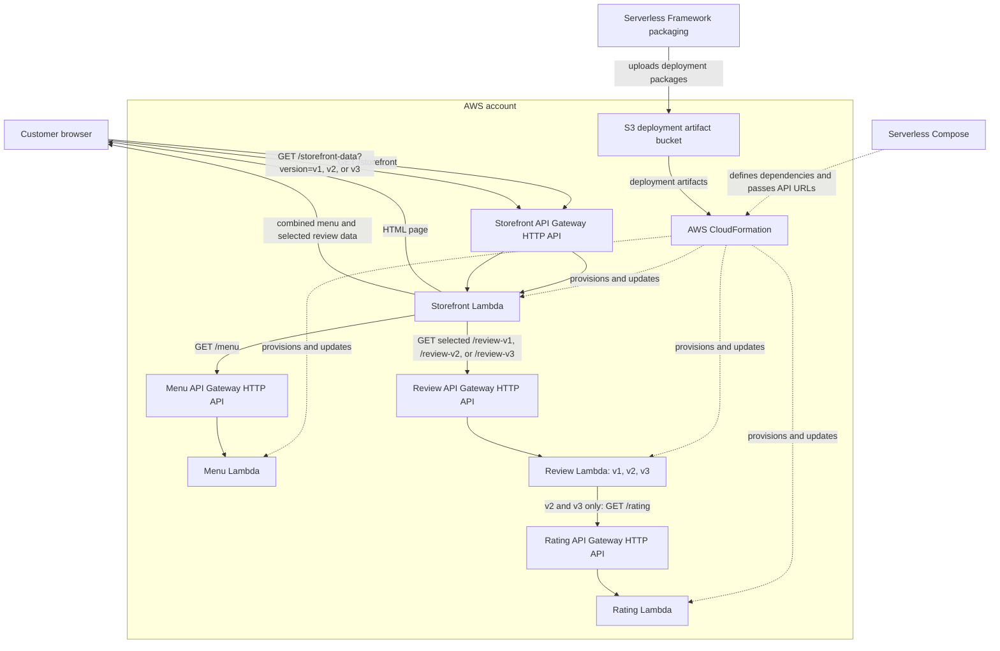

# CoffeeShop (Serverless Compose)

CoffeeShop is a multi-service serverless application deployed with Serverless
Framework Compose. The storefront serves the web page from AWS Lambda and
aggregates menu and review data from independent APIs. Review v1 returns reviews
without ratings; v2 and v3 also fetch ratings from rating-service.

## Technology stack

- **Serverless Framework v4 with Compose** defines the services, deployment
  dependencies, and API URL parameter wiring.
- **AWS Lambda** runs the storefront, menu, review, and rating handlers on the
  Node.js 24 runtime.
- **Amazon API Gateway HTTP API** exposes each service's HTTP endpoints.
- **AWS CloudFormation** provisions and updates the AWS resources for each
  service stack.
- **Amazon S3** stores deployment artifacts uploaded by Serverless Framework
  for CloudFormation deployments. It does **not** host the storefront website;
  the storefront HTML is included in the storefront Lambda package and returned
  by `GET /storefront`.

## Architecture



The browser calls the storefront API. Its data handler requests menu and
selected review data concurrently. Review v2 and v3 call the rating API; v1
does not. Serverless Compose connects the API URLs without hard-coding deployed
API IDs. Each service is managed by CloudFormation, and S3 is used for
deployment artifacts rather than as the web origin.

Unlike the manual-orchestration project, Compose resolves service dependencies
and passes the resulting API URLs between services. You do not need to deploy
services one by one, copy endpoint URLs into configuration, or remove each
service separately.

## Services and endpoints

| Service | Method and path | Behavior |
| --- | --- | --- |
| `storefront` | `GET /storefront` | Returns the HTML page. |
| `storefront` | `GET /storefront-data?version=1` | Returns combined menu and v1 reviews. Supports `1`, `2`, `3`, `v1`, `v2`, or `v3`; defaults to v1. |
| `menu-service` | `GET /menu` | Returns all menu items. |
| `menu-service` | `GET /menu?category=pastry` | Filters by `signature`, `molecular`, `botanical`, or `pastry`; `all` returns every item. |
| `review-service` | `GET /review-v1` | Returns reviews without ratings. |
| `review-service` | `GET /review-v2` | Returns reviews with ratings. |
| `review-service` | `GET /review-v3` | Returns reviews with ratings. |
| `rating-service` | `GET /rating` | Returns ratings used by review-service v2 and v3. |

Invalid versions/categories return HTTP 400. If a downstream service fails,
the storefront aggregator returns HTTP 502 and logs the cause.

## Data flow and contracts

The menu service returns an `items` array. Items contain `id`, `category`,
`name`, `description`, numeric `price`, and `tag`.

Review-service returns a `version` and `reviews` array. Review entries contain
`id`, `reviewer`, `text`, and `detail`. Versions 2 and 3 also include a numeric
`rating` from 0 to 5 (or `null` if no rating exists).

Rating-service returns ratings keyed by reviewer ID:

```json
{
  "ratings": {
    "elena": 5,
    "marcus": 5,
    "clara": 4.8
  }
}
```

The storefront data response combines the menu with the selected reviews:

```json
{
  "menu": [],
  "version": "v2",
  "reviews": {
    "version": "v2",
    "reviews": []
  }
}
```

## Project layout

```text
.
├── serverless-compose.yml
├── menu-service/
│   ├── handler.js
│   └── serverless.yml
├── rating-service/
│   ├── handler.js
│   └── serverless.yml
├── review-service/
│   ├── handler.js
│   └── serverless.yml
└── storefront/
    ├── handler.js
    ├── index.html
    └── serverless.yml
```

## Requirements

- Node.js 24-compatible AWS Lambda runtime.
- Serverless Framework v4.3.1 or newer for Compose.
- AWS credentials with permissions for Lambda, API Gateway, IAM, CloudFormation,
  and deployment artifacts.
- Access to the Serverless organization configured in the manifests.

Handlers use Node.js built-ins and built-in `fetch`; there are no runtime npm
dependencies.

## Deploy with Serverless Compose

Run Compose commands from this directory, where
[`serverless-compose.yml`](./serverless-compose.yml) is located.

One command deploys the complete service stack. Compose handles dependency
order and endpoint URL wiring automatically:

```bash
serverless deploy
```

To deploy only the storefront and the services it depends on:

```bash
serverless storefront deploy
```

Inspect deployed endpoint URLs and outputs:

```bash
serverless info
```

Compose establishes this deployment order and parameter wiring:

1. `rating-service.ApiUrl` is passed to review-service as `RATINGS_URL`, with
   `/rating` appended.
2. `menu-service.ApiUrl` and `review-service.ApiUrl` are passed to storefront
   as `MENU_SERVICE_URL` and `REVIEWS_SERVICE_URL`.
3. The storefront appends `/menu` and the selected `/review-v1`, `/review-v2`,
   or `/review-v3` path.

Use a consistent stage and region for the service graph. For a separate stage:

```bash
serverless deploy --stage staging --region us-east-1
```

## Remove the stack

Remove all services managed by this Compose project with one command from this
directory; individual `serverless remove` commands are not needed:

```bash
serverless remove
```

For a non-default stage, specify the same stage and region used to deploy:

```bash
serverless remove --stage staging --region us-east-1
```

## Verify

Use the API base URLs printed by `serverless info`:

```bash
curl -i "https://<storefront-api-id>.execute-api.<region>.amazonaws.com/storefront"
curl -i "https://<storefront-api-id>.execute-api.<region>.amazonaws.com/storefront-data?version=v1"
curl -i "https://<storefront-api-id>.execute-api.<region>.amazonaws.com/storefront-data?version=v2"
curl -i "https://<storefront-api-id>.execute-api.<region>.amazonaws.com/storefront-data?version=v3"
curl -i "https://<menu-api-id>.execute-api.<region>.amazonaws.com/menu?category=pastry"
curl -i "https://<review-api-id>.execute-api.<region>.amazonaws.com/review-v1"
curl -i "https://<review-api-id>.execute-api.<region>.amazonaws.com/review-v2"
curl -i "https://<review-api-id>.execute-api.<region>.amazonaws.com/review-v3"
curl -i "https://<rating-api-id>.execute-api.<region>.amazonaws.com/rating"
```

Open `/storefront#reviews` and select v1, v2, or v3. v1 displays reviews
without ratings; v2 and v3 display ratings.

## Production considerations

This is a demonstration, not a production-ready customer service:

- APIs are public and responses allow wildcard CORS. Add authorization and
  restrict browser origins before public production use.
- Menu, review, and rating data are in memory. Add a durable, managed data
  source for operational data.
- The menu order buttons and other non-menu storefront features are UI
  demonstrations and do not submit transactions.
- Add downstream timeouts, observability/alarms, log retention, throttling,
  automated tests, and deployment approval/rollback controls.
- Review third-party frontend assets, privacy implications, and Content
  Security Policy requirements.

AWS credentials should come from the standard credential chain or approved CI
secret storage. Do not commit secrets or local `.env` files.
